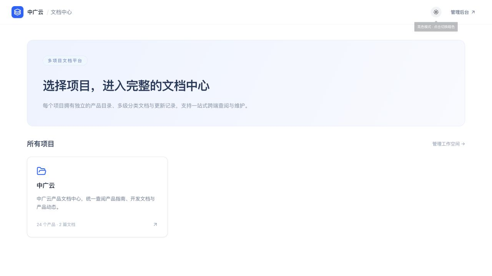
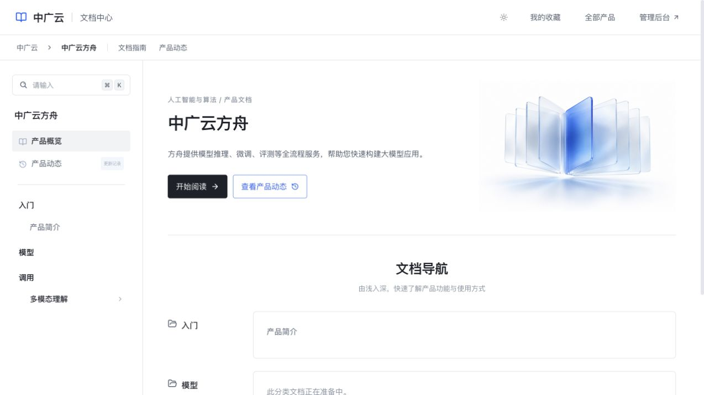
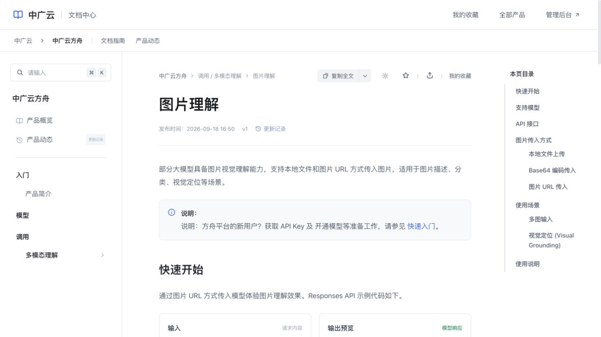
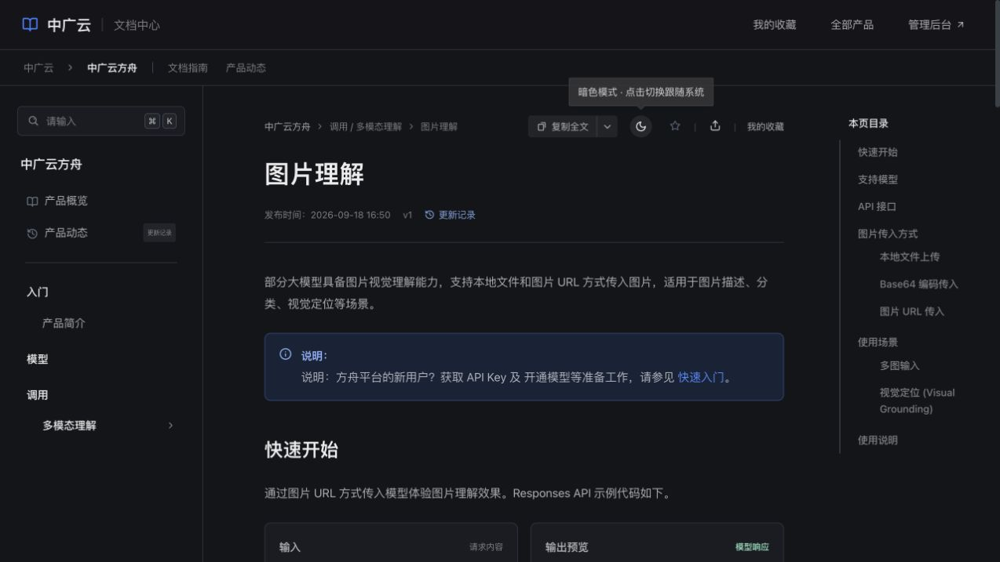
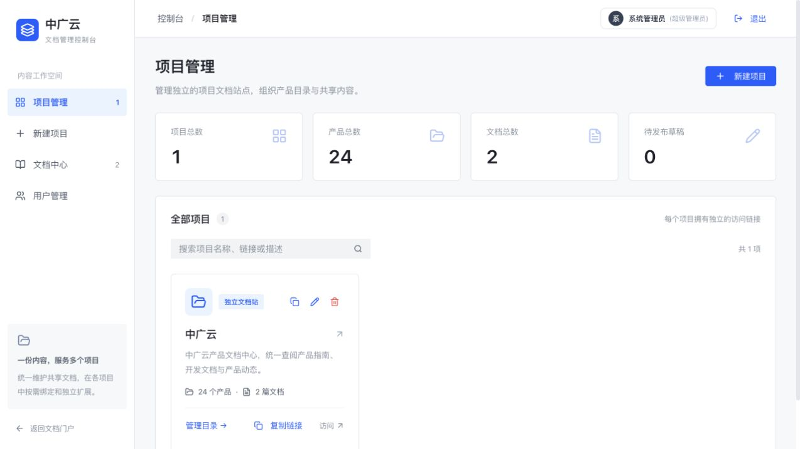
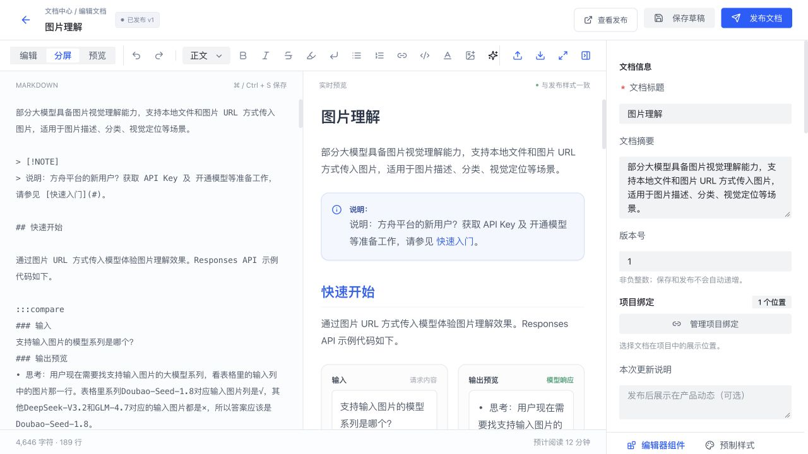
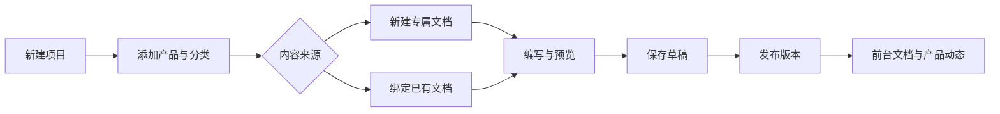

# Multi-document · 多项目文档中心

一个可本地运行的多项目文档平台：用一套后台维护项目、产品、目录和文档，将同一份内容发布到多个独立文档站点。

基于 **Next.js 14 · React 18 · TypeScript · Arco Design**，内置 Markdown 编辑器、26 种内容组件、草稿与发布版本、历史快照、后台账号权限和统一亮暗主题。


> 本页截图来自项目自动生成的初始示例环境。仓库不包含本机已有的文档数据、用户数据或上传附件。

[快速开始](#快速开始) · [界面展示](#界面展示) · [功能一览](#功能一览) · [使用流程](#使用流程) · [部署与数据](#部署与数据) · [详细使用指南](docs/USER_GUIDE.md)

## 快速开始

推荐使用 **Node.js 24** 和 npm。已在 Node.js 24.20.0 上验证启动、类型检查、生产构建和主要测试。

```bash
git clone https://github.com/yww900-cloud/Multi-document.git
cd Multi-document
npm ci
npm run dev
```

打开：

| 页面 | 本地地址 |
| --- | --- |
| 文档总首页 | http://localhost:4000/ |
| 示例项目文档中心 | http://localhost:4000/projects/zhongguang |
| 示例产品首页 | http://localhost:4000/projects/zhongguang/products/ark |
| 后台控制台 | http://localhost:4000/admin |

首次访问会自动创建 `data/store.json`、示例项目、产品目录和两篇示例文档，无需手工导入数据或安装数据库。

### 后台演示账号

| 账号 | 初始密码 | 默认角色 |
| --- | --- | --- |
| `admin` | `admin123` | 管理员 |
| `operator` | `operator123` | 编辑人员 |

这些账号用于本地体验。正式使用前，在后台用户管理中修改初始密码、检查角色权限，并设置独立的 `ADMIN_AUTH_SECRET`。

## 界面展示

### 1. 文档总首页：一个入口访问多个项目

每个项目拥有独立访问链接、产品目录和内容绑定。总首页展示各项目的产品数与可见文档数。



### 2. 产品首页：从概览进入分类文档

左侧是产品文档目录，右侧呈现产品介绍、阅读入口、分类导航和产品动态。支持上传产品图片或视频。



### 3. 文档阅读：目录、正文与操作栏

提供多级目录、页内导航、代码高亮、多语言代码标签、复制全文、收藏、二维码分享和上一篇 / 下一篇导航。



### 4. 暗色模式：所有公共页面共用一份设置

总首页、项目首页、产品首页在顶栏切换外观；文档阅读页使用正文操作栏中的图标。模式按 **跟随系统 → 亮色 → 暗色** 循环，选择保存在当前浏览器，并同步到其他页面和标签页。

正文、卡片、表格、折叠块、参数标签、搜索结果、历史预览和流程图均提供暗色适配，悬停时保持暗色背景。



### 5. 后台项目管理：独立站点与共享内容

新建或复制项目，管理产品分组、多级分类和文档绑定。共享文档可统一更新，也可复制为独立内容。



### 6. 文档编辑器：编写、预览、保存和发布

Markdown 编辑与实时预览、预制样式、内置组件、目录绑定和更新说明集中在同一编辑界面。



## 功能一览

| 领域 | 支持能力 |
| --- | --- |
| 多项目管理 | 项目名称、公司品牌、独立链接、简介、项目复制及品牌变量 |
| 产品与目录 | 产品大类、多级分类、目录排序、移动分类、图片 / 视频展示 |
| 共享内容 | 跨项目 / 产品绑定同一文档，复制专属文档，发布后统一同步 |
| 编辑与发布 | Markdown 导入导出、实时预览、撤销重做、草稿隔离、更新说明、并发保存冲突检测 |
| 历史与动态 | 真实发布版本快照、产品动态、历史内容预览 |
| 阅读体验 | 全局搜索、页内目录、复制正文 / Markdown、收藏、二维码分享、亮暗主题 |
| 内容组件 | 代码、表格、流程图、公式、提示块、卡片、媒体画廊、API 参数等 26 种组件 |
| 上下架 | 产品分组、文档分类和文档可控制可见性，父分类隐藏会级联隐藏下级内容 |
| 后台权限 | 用户、角色、操作权限、自定义权限及登录会话 |
| 文件附件 | 图片粘贴与上传、产品视频、PDF / Office / ZIP 等附件 |

### 内置内容组件

| 类别 | 组件 |
| --- | --- |
| 内容强调 | 状态徽章、引用、信息提示、成功 / 建议、注意事项 |
| 技术内容 | 快捷键、多语言代码、参数表格、流程图、数学公式、专业表格、API Explorer、请求参数列表 |
| 结构排版 | 折叠详情、双栏对比、步骤说明 |
| 卡片与导航 | 导航卡片、特性亮点、横幅卡片、能力入口、附件下载 |
| AI 与多模态 | 提示词生图对比、视频网格、多模态展示、分镜脚本、关键帧画廊 |

示例：

````markdown
> [!NOTE] 说明
> 保存草稿不会修改前台已发布内容。

:::cards cols=2
### [快速入门](/projects/zhongguang/products/ark/docs/doc-intro)
了解产品能力与基本使用方式。
:::

```typescript
const message = "Hello, Multi-document!";
```
````

组件的完整写法可在编辑器组件栏插入后查看，更多操作见 [详细使用指南](docs/USER_GUIDE.md)。

## 使用流程



1. **组织目录**：创建项目，添加产品大类、产品和多级文档分类。
2. **准备内容**：新建文档，或将已有文档绑定到目标项目 / 产品 / 分类。
3. **编写与预览**：插入组件、图片和附件，设置样式及目录绑定。
4. **保存草稿**：保存未完成的修改，前台继续展示已发布版本。
5. **发布更新**：填写更新说明，生成发布版本和历史快照。
6. **查阅与维护**：前台搜索阅读，后台调整目录、复制项目和控制上下架。

## 部署与数据

### 生产模式

```bash
cp .env.example .env.local
# 编辑 .env.local，为 ADMIN_AUTH_SECRET 设置独立随机值。
npm run build
npm start
```

可用以下命令生成随机会话密钥，再将结果填入 `.env.local`：

```bash
node -e "console.log(require('crypto').randomBytes(32).toString('hex'))"
```

默认端口为 `4000`。需要独立开发端口时：

```bash
NEXT_DIST_DIR=.next-dev npx next dev -p 4001
```

### 数据存储与备份

| 路径 | 内容 |
| --- | --- |
| `data/store.json` | 项目、产品、目录、文档、草稿、发布历史、后台用户与角色 |
| `data/uploads/` | 图片、视频和附件文件 |
| `.env.local` | 本地配置与会话签名密钥 |

`data/` 和环境配置文件均被 Git 忽略。迁移或备份时，应在停止写入后同时备份 `store.json` 和 `uploads/`；不要将真实账号数据和附件提交到公开仓库。

当前实现使用本地 JSON 文件和原子替换保存，面向 **单实例、可写磁盘** 的运行方式。部署时挂载持久化磁盘；多实例共享写入需要先改造存储层。收藏保存在访客浏览器内，不跨设备同步。

### 项目结构

```text
src/
  app/            页面、后台与 API 路由
  components/     门户、阅读、编辑器与管理组件
  lib/            数据存储、权限、Markdown、安全过滤与主题逻辑
public/images/    门户静态插图
tests/          组件与集成测试
docs/            图文说明、截图和详细使用指南
data/            首次启动生成的本地数据（不提交）
```

## 开发与验证

```bash
npm run typecheck
npm run build
npm run test:components
npm run test:icons
npm run test:codewrap
npm run test:htmltabs
```

集成测试需要先启动服务。建议在独立测试目录运行，避免影响正在使用的工作空间：

```bash
TEST_BASE_URL=http://localhost:4000 npm run test:integration
TEST_BASE_URL=http://localhost:4000 npm run test:media
TEST_BASE_URL=http://localhost:4000 npm run test:reorder
TEST_BASE_URL=http://localhost:4000 npm run test:groups
TEST_BASE_URL=http://localhost:4000 npm run test:expansion
```

集成测试创建并清理临时项目及文档，覆盖共享与专属文档、草稿隔离、发布快照、媒体上传、目录移动、排序及冲突保护。分类图标检查可用 `npm run test:category-icons` 单独运行。

## 更多说明

- [详细使用指南](docs/USER_GUIDE.md)：组件语法、媒体限制、共享绑定、变量替换及上下架规则。
- 本仓库上传源码与静态资源，真实业务数据由各部署环境独立维护。
- 示例文档用于展示阅读与编辑能力，其中的产品描述和 API 示例不应作为第三方服务的最新规范。

## 演示数据种子（seed）

Docker 全新部署默认自带一套开箱可看的演示数据，交付演示时不需要手工建任何内容：

- **两个演示站点**：中广云（全量产品线）与大数据（收敛后的 7 个主题产品），产品、文档、挂载、版本快照齐全；
- **五篇文档**：产品简介、图片理解（共享版 / 大数据专属版各一篇）、湖仓一体 LAS 快速入门、VikingDB 实践指南；
- **开关**：`SEED_DEMO=false docker compose up -d` 即可跳过灌入，得到纯空库；
- **幂等**：seed 只在 `projects` 表为空时执行，重复 `docker compose up` 不会重复灌入；强制重灌设 `SEED_DEMO_FORCE=1`；
- **不含账号**：默认角色与 admin/operator 账号仍由应用首次读取时自动初始化。

维护方式：本地把数据调整满意后运行 `npm run seed:export`，当前库的演示内容会固化到 `seed/demo-seed.json`（提交入库）；Docker 部署时 seed 服务读取该文件灌入。手动向本地库灌一遍可用 `npm run seed:run`。

若交付目标是不允许出现演示数据的环境，设 `SEED_DEMO=false`，或部署后在页面上直接删除对应项目即可。
